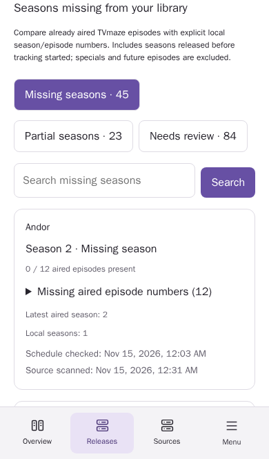

# Tendstead Lookout

A self-hosted overview for your films, series and public videos.

Lookout inventories an existing NAS over read-only SFTP, browses films and series,
and enriches them from Jellyfin/Plex and optional TVmaze lookups. Collections keep
their existing folders; individual films appear as separate cards. ZIP-contained
videos appear as archive members without extraction.

Follow series/anime for upcoming episodes and provider-reported season premieres.
Poster cards show missing and partial aired seasons, episode coverage and local
season chips, with uncertain numbering separated for review. The first successful
schedule fetch establishes a silent baseline. Optional Telegram alerts apply to
future releases; verifying the bot/chat sends no test message.
Lookout does not download, play, move, rename or delete media.

## Run

Requires Docker Engine with Compose/Buildx, Make, and an existing PostgreSQL server with a dedicated Lookout
database and login role. Follow [database setup](docs/deployment.md), then:

```sh
cp .env.example .env
# Set the database URL, password-file path and database Docker network in .env.
make build
docker compose up -d --no-build --wait
```

Open <http://localhost:8083>. To use Lookout on a phone, set `LISTEN_ADDR=0.0.0.0`
in `.env`, recreate the app with `docker compose up -d --no-build --wait`, and visit
`http://<your-computer-LAN-address>:8083` while connected to the same local network.
Lookout has no application login and is intended for a trusted network.

`docker compose down` stops Lookout; its dedicated database stays on your PostgreSQL
server. Language and theme are saved separately on each device.

## Screenshots

| Desktop | Phone |
| --- | --- |
|  |  |

Configure [read-only library and integrations](docs/library.md). See [deployment](docs/deployment.md), [API](docs/api.md), and
[development and checks](docs/development.md) for more details.

## License

[Elastic License 2.0](LICENSE) (`Elastic-2.0`). Third-party components retain their
own licenses; see [third-party notices](docs/third-party/README.md).
